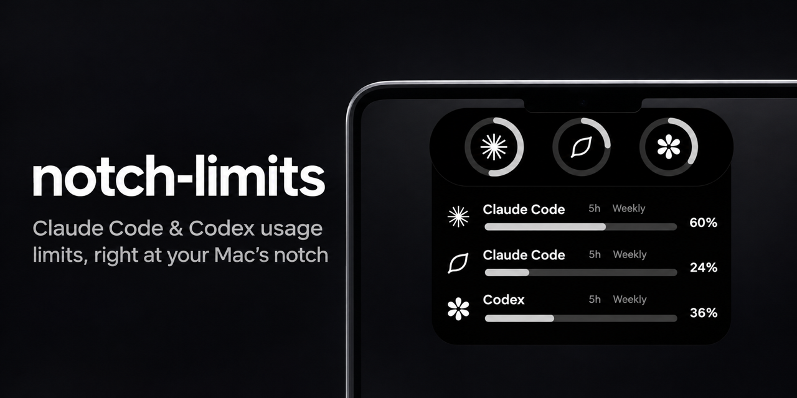
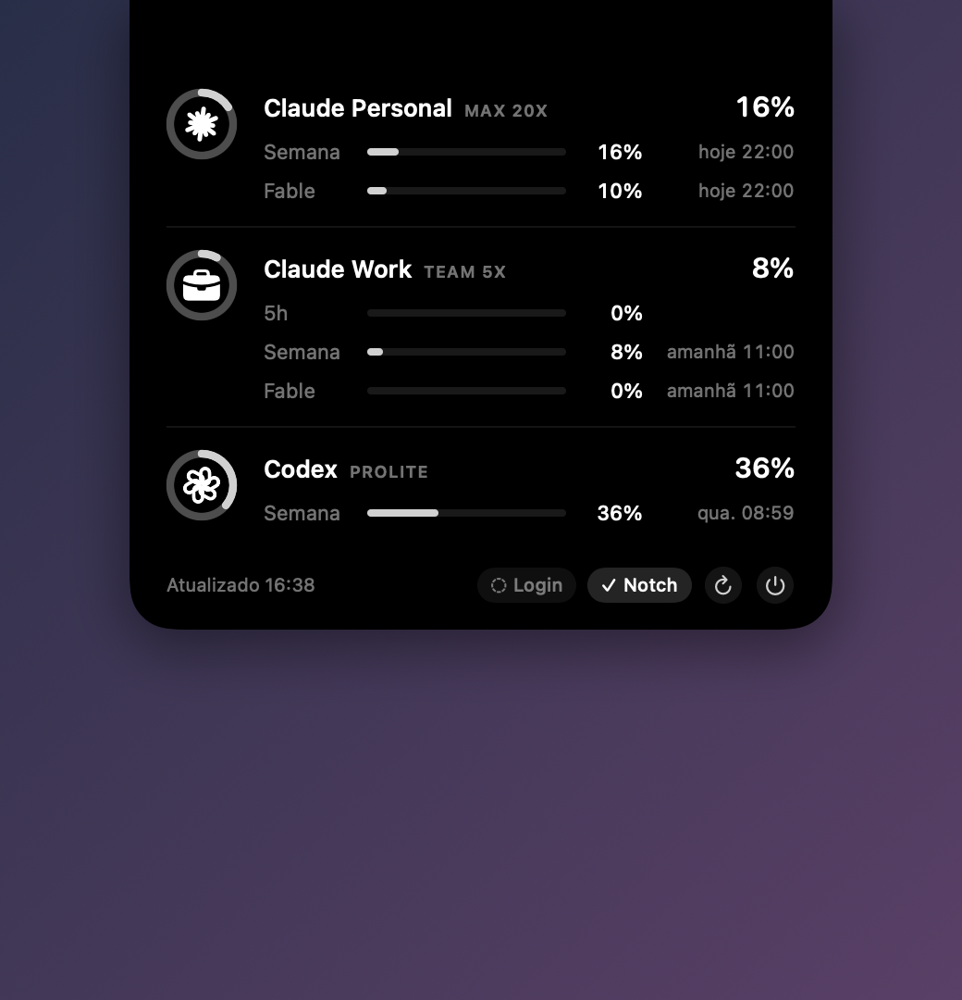

<p align="center">
  
</p>

<p align="center">
  
  
  
  
  
</p>

# notch-limits

**A tiny native macOS app that shows your Claude Code and OpenAI Codex usage limits around the MacBook notch.** It covers the 5-hour session limit, the weekly limit and per-model limits, for as many accounts as you use.

The notch area becomes a Dynamic Island-style pill with one progress ring per account. Hover over it and it expands to show every rate-limit window, its percentage and when it resets. On Macs without a notch it falls back to a menu bar item.

If you juggle **multiple Claude Code accounts** (for example personal Max and a work Team plan via `CLAUDE_CONFIG_DIR`) and a **ChatGPT/Codex** plan, you can see at a glance which one still has quota left, without running `/usage` in each terminal.

<p align="center">
  <br>
  
</p>

## Features

- **Notch HUD:** progress rings attached to the notch that expand on hover, like a Dynamic Island for your AI quotas.
- **Menu bar fallback:** the menu bar icon appears automatically when no screen has a notch (for example clamshell mode with an external monitor) or when notch mode is off.
- **Claude Code limits:** session (5h), weekly (all models) and weekly per-model limits (e.g. Opus/Fable), with exact reset times.
- **Codex limits:** primary and secondary rate-limit windows for ChatGPT plans (Plus, Pro, Team…).
- **Multiple accounts:** any number of Claude Code config dirs plus Codex homes.
- **Colors only when needed:** neutral gray rings, orange at 70% and red at 90%.
- **Read-only and local:** it reuses the credentials your CLIs already store. It never refreshes, rewrites or uploads tokens anywhere other than the official usage endpoint.
- **Small and dependency-free:** pure Swift + SwiftUI. It refreshes every 5 minutes and on hover.
- **Launch at login** toggle built in.

## Requirements

- macOS 14 Sonoma or later (the notch HUD needs a MacBook with a notch)
- Xcode Command Line Tools (`xcode-select --install`)
- Logged in to [Claude Code](https://docs.anthropic.com/en/docs/claude-code) with a Claude subscription (Pro/Max/Team) and/or [Codex CLI](https://github.com/openai/codex) with ChatGPT sign-in

## Install

```bash
git clone https://github.com/matheusm/notch-limits.git
cd notch-limits
./build.sh
```

`build.sh` compiles a release build, wraps it in `~/Applications/NotchLimits.app` (ad-hoc signed, no Dock icon) and launches it. Run it again after pulling updates.

## Configuration

Out of the box, it tracks the default Claude Code account (`~/.claude`) and Codex (`~/.codex`).

To track more accounts, create `~/.config/notch-limits/accounts.json`:

```json
[
  { "name": "Claude Personal", "provider": "claude", "path": "~/.claude", "icon": "claude" },
  { "name": "Claude Work", "provider": "claude", "path": "~/.claude-work", "icon": "briefcase.fill" },
  { "name": "Codex", "provider": "codex", "path": "~/.codex", "icon": "codex" }
]
```

| Field | Description |
| --- | --- |
| `name` | Label shown in the expanded panel |
| `provider` | `claude` or `codex` |
| `path` | Claude: the `CLAUDE_CONFIG_DIR` of that account (default `~/.claude`). Codex: the `CODEX_HOME` (default `~/.codex`) |
| `icon` | `claude`, `codex`, or any [SF Symbol](https://developer.apple.com/sf-symbols/) name (`leaf.fill`, `briefcase.fill`, `building.2.fill`…) |

The accounts are split between the two sides of the notch in order: the first half on the left, the rest on the right. Restart the app after editing the file.

### Multiple Claude Code accounts

Claude Code keeps one login per config directory. A common setup is one alias per account:

```bash
# ~/.zshrc
alias claude-work='CLAUDE_CONFIG_DIR=$HOME/.claude-work claude'
```

Log in once with `claude-work`, add `~/.claude-work` to `accounts.json`, and its limits will show up.

## Usage

| Action | Result |
| --- | --- |
| Hover the notch | Expands the panel with every limit window and reset time |
| Move the mouse away | Collapses back to the rings |
| **Notch** chip | Turn the notch HUD off and use the menu bar item instead |
| **Login** chip | Launch at login |
| ↻ / ⏻ | Refresh now / quit |

Each ring shows the **highest** usage among that account's windows, since that is the limit you will hit first.

## How it works

| Provider | Credentials (read-only) | Endpoint |
| --- | --- | --- |
| Claude Code | macOS Keychain item `Claude Code-credentials` (or `Claude Code-credentials-<sha256(config dir)[:8]>` for custom `CLAUDE_CONFIG_DIR`) | `GET https://api.anthropic.com/api/oauth/usage` |
| Codex | `$CODEX_HOME/auth.json` | `GET https://chatgpt.com/backend-api/wham/usage` |

These are the same endpoints that Claude Code's `/usage` and Codex's `/status` use. The Keychain is read through `/usr/bin/security`, which is already on the item's access list, so there is no permission prompt.

## Troubleshooting

- **"Token expirado — abra o CLI para renovar"** (token expired, open the CLI to renew it): access tokens are short-lived, and notch-limits never refreshes them on purpose, to avoid racing your CLI. Run `claude` (or `claude-work`, `codex`…) once and the account comes back on the next refresh.
- **"Rate limit da API"** (API rate limit): the usage endpoint was polled too often. The next 5-minute refresh will recover it.
- **Nothing next to the notch:** check that the built-in display is active. In clamshell mode the app automatically switches to the menu bar.

## Notes

- The UI is currently in Brazilian Portuguese (pt-BR). PRs adding localization are welcome.
- The endpoints above are undocumented and may change without notice.
- This is an unofficial community project. It is not affiliated with or endorsed by Anthropic or OpenAI. "Claude" and "Codex" are trademarks of their respective owners.

## License

[MIT](LICENSE)
